# 🛡️ NetGuard AI — Network Anomaly Detection & Autonomous SOC Platform

> **AI-Powered Network Intrusion Detection System (NIDS) + Enterprise Security Operations Center (SOC) Platform**  
> Built for the **Major Project** (Bachelor of Engineering — Computer Science) by **Aditya Raikar**.


---

## 📌 Table of Contents

1. [Project Overview](#-project-overview)
2. [Key Features](#-key-features)
3. [System Architecture](#-system-architecture)
4. [Project Structure](#-project-structure)
5. [Dual-Mode Live Traffic Ingestion & Flow Engine](#-dual-mode-live-traffic-ingestion--flow-engine)
6. [Enterprise Auth, Multi-Tenancy & History Persistence](#-enterprise-auth-multi-tenancy--history-persistence)
7. [Multi-Channel Alert Notification Engine](#-multi-channel-alert-notification-engine)
8. [Datasets Used](#-datasets-used)
9. [Machine Learning Pipeline & Performance](#-machine-learning-pipeline--performance)
10. [Autonomous Agentic AI & SOC Multi-Agent Swarm](#-autonomous-agentic-ai--soc-multi-agent-swarm)
11. [Publication-Grade System Documentation (PDF)](#-publication-grade-system-documentation-pdf)
12. [API Endpoints Reference](#-api-endpoints-reference)
13. [Installation & Setup](#-installation--setup)
14. [Running the Application](#-running-the-application)
15. [Automated Test Suite (61 Tests)](#-automated-test-suite-61-tests)
16. [Results & Visualizations](#-results--visualizations)
17. [Web Application Screenshots](#-web-application-screenshots)
18. [Security, Privacy & Deployment Safety](#-security-privacy--deployment-safety)
19. [Technologies Used](#-technologies-used)
20. [Author & Acknowledgments](#-author--acknowledgments)

---

## 📖 Project Overview

Cyber attacks and distributed intrusion techniques are increasing exponentially, necessitating sub-second automated threat mitigation. **NetGuard AI** is a complete, enterprise-ready **Network Intrusion Detection System (NIDS)** and **Security Operations Center (SOC)** platform that autonomously inspects network traffic, identifies zero-day and known anomalous attack vectors, explains root causes via explainable AI, and executes containment playbooks in real time.

Trained and cross-validated on two flagship cybersecurity benchmark datasets:
- **NSL-KDD** (KDDTrain+ / KDDTest-21)
- **CICIDS-2017** (Multi-day PCAP flow captures)

NetGuard AI achieves **99.9% accuracy** and sub-5ms inference latency. Beyond passive classification, the platform features:
1. **Dual-Mode Live Traffic Ingestion**: Live hardware NIC packet interception using Scapy and high-velocity synthetic flow injection.
2. **Autonomous ReAct SOC Copilot**: Tier-2 reasoning loop powered by Groq ultra-fast LLMs (`llama-3.3-70b-versatile` / `openai/gpt-oss-120b`), completing investigations in under 7 seconds.
3. **Multi-Agent Incident Swarm**: Hierarchical coordination of Supervisor, Forensics, Threat Intel, and Remediation agents outputting STIX 2.1 bundles.
4. **Enterprise Multi-Tenant Security**: Role-based access control (RBAC), bcrypt salted cryptography, JWT token authorization, and persistent user investigation history across email sessions.
5. **Interactive MITRE ATT&CK Matrix & Cryptographic Case Packager**: Digital evidence sealing adhering to ISO/IEC 27037 digital forensics standards.

---

## ✨ Key Features

- **Dual-Dataset Anomaly Detection**
  - Production Random Forest engines for **CICIDS-2017** (78 features) and **NSL-KDD** (41 features).
  - Evaluates confidence, attack probability, calibrated risk score (0–100), and categorical severity tier.

- **Dual-Mode Live Traffic Ingestion & Flow Assembly**
  - **Mode A (Hardware Interface Sniffer)**: Live packet capture on physical network adapters using Scapy; automatically aggregates packets into bidirectional 5-tuple flows (duration, byte/packet volumes, flag ratios, inter-arrival times).
  - **Mode B (High-Velocity Offline Replay)**: Automated synthetic traffic generator for air-gapped simulation, stress testing, and benchmark validation.

- **Enterprise Authentication & Cross-Login History Persistence**
  - Secure signup and login with email verification, bcrypt password hashing (12 rounds), and cryptographically signed JWT access tokens.
  - Multi-tenant isolation: alerts and autonomous investigation history are persisted in SQLite (WAL mode) and automatically reloaded whenever the user relogins with their email.

- **Autonomous Agentic AI Copilot (Powered by Groq Acceleration)**
  - ReAct framework (`Thought -> Action -> Observation`) executing 6 cyber security tools.
  - Accelerated with Groq LLM integration, slashing end-to-end multi-step investigations from 47 seconds to under 7 seconds.
  - Full fallback resiliency to Gemini and embedded deterministic policy rules with a zero-crash guarantee.

- **Multi-Channel Alert Notification Engine**
  - Configurable dispatch to Webhooks (Slack, Microsoft Teams, Discord, custom SIEMs) and SMTP email alerts.
  - Smart alert deduplication and rate-limiting to prevent SOC fatigue during massive distributed attacks.

- **Forensic PCAP Parser & DPI Engine**
  - Pure-Python binary PCAP/PCAPNG packet parser (`src/pcap_extractor.py`) extracting 28 statistical flow features with zero Wireshark dependencies.

- **Interactive MITRE ATT&CK® Enterprise Matrix Navigator**
  - Full 14-tactic Cyber Kill Chain coverage (`TA0043`–`TA0040`) with live threat heatmaps and deep technique inspection.

- **Adversarial Red-Team Evasion Tester**
  - Simulates 4 evasion vectors: Jitter & Header Padding, Low-and-Slow Rate Throttling, TCP Chameleon Masking, and Boundary Feature Perturbation. Computes a quantitative **Robustness Index**.

- **Cryptographic Case Packager (ISO/IEC 27037 Compliant)**
  - 1-click forensic dossier exporter bundling SHA-256 sealed manifest, executive HTML report, Linux/Windows containment scripts, Snort/Suricata IDS rules, STIX 2.1 JSON, and raw telemetry CSV.

- **Rich Streamlit SOC Dashboard with 16 Pages**
  - Dark cyber / light enterprise theme, glassmorphism, 3D WebGL neural topology visualizer, live activity feed, and dedicated settings for API latency diagnostics.

---

## 🏗️ System Architecture

```
┌─────────────────────────────────────────────────────────────────────────────────────────┐
│                    STREAMLIT SOC DASHBOARD (frontend/dashboard.py)                       │
│  Overview · Live Traffic Monitor · Threat Detection · ⚡ Agentic SOC Copilot · MITRE     │
│  Adversarial Red-Team · 3D Topology · User Alert History · Latency Diagnostic Console    │
└────────────────────────────────────────────┬────────────────────────────────────────────┘
                                             │ HTTP REST / WebSocket (Port 8000)
┌────────────────────────────────────────────▼────────────────────────────────────────────┐
│                             FASTAPI BACKEND (frontend/app.py)                           │
│  /auth/* · /predict/* · /analyze/* · /monitor/* · /detection/* · /notifications/*       │
│  /agent/investigate · /agent/hunt · /agent/swarm · /chat · /health · /api/status        │
└────────┬───────────────────┬────────────────────┬────────────────────┬──────────────────┘
         │                   │                    │                    │
┌────────▼────────┐ ┌────────▼─────────┐ ┌────────▼──────────┐ ┌───────▼────────────────┐
│  ML PREDICTION  │ │ LIVE INGESTION   │ │  AGENTIC SOC      │ │  ENTERPRISE PERSISTENCE│
│  ENGINE         │ │ & FLOW SNIFFER   │ │  FRAMEWORK        │ │  & MULTI-TENANCY       │
│ • CICIDS-2017 RF│ │ • Scapy Sniffer  │ │ • Groq ReAct Agent│ │ • SQLite WAL Engine    │
│ • NSL-KDD RF    │ │ • Flow Assembler │ │ • Multi-Agent     │ │ • Bcrypt Hash (12 rnd) │
│ • Risk Scorer   │ │ • Synthetic Gen  │ │   Swarm (STIX 2.1)│ │ • JWT Token Validator  │
│ • XAI Attribution││ • Sliding Window │ │ • Drift Hunter    │ │ • Per-User History     │
└────────┬────────┘ └────────┬─────────┘ └────────┬──────────┘ └───────┬────────────────┘
         │                   │                    │                    │
┌────────▼───────────────────▼────────────────────▼────────────────────▼────────────────┐
│                           SECURITY TOOLS & KNOWLEDGE REGISTRY                         │
│   • Threat Intel (IOCs) · Multiclass Classifier · MITRE Mapping · SOAR Containment    │
│   • Multi-Channel Notifications (Webhook/Email) · 12-Document Curated RAG Vector Store│
└───────────────────────────────────────────────────────────────────────────────────────┘
```

---

## 📂 Project Structure

```text
Network Anamoly Detection/
│
├── backend/                              # FastAPI Service Routers
│   ├── auth_routes.py                    # 🔐 JWT Signup, Login, Profile & Multi-Tenant History
│   ├── monitor_routes.py                 # 📡 Live Sniffer Control & Hardware Interface Listing
│   ├── detection_routes.py               # ⚡ Real-Time Streaming Detection & Flow Sockets
│   ├── notification_routes.py            # 🔔 Webhook, Slack & Email Dispatch Control
│   ├── main.py                           # Application Router Aggregator
│   ├── predictor.py                      # Model inference adapter
│   ├── dataset_analyzer.py               # CSV/PCAP dataset schema identifier
│   └── rag/                              # RAG SOC Knowledge Base Subsystem
│       ├── config.py                     # LLM & Vector Store settings
│       ├── generator.py                  # Multi-provider LLM dispatch (Groq/Gemini/OpenAI)
│       ├── retriever.py                  # TF-IDF / Semantic similarity retriever
│       └── documents/                    # 12+ Curated SOC operational guides
│
├── frontend/                             # Streamlit SOC Command Center
│   ├── dashboard.py                      # ⭐ 16-Page SOC Dashboard (Live Traffic, Swarm, Auth)
│   ├── app.py                            # ⭐ Primary FastAPI Application Entrypoint
│   ├── auth_client.py                    # Client-side Auth & JWT Token Manager
│   ├── ui_components.py                  # Cyber design system, badges & radar panels
│   └── api.py                            # Resilient API communication client
│
├── src/                                  # Core Engines & Autonomous Agents
│   ├── prediction_engine.py              # Central dual-dataset ML inference engine
│   ├── live_monitor.py                   # 📡 Scapy packet sniffer & flow assembler
│   ├── realtime_detector.py              # ⚡ Real-time continuous flow detector
│   ├── notification_engine.py            # 🔔 Multi-channel webhook & email dispatcher
│   ├── auth.py                           # 🔑 Bcrypt password hashing & JWT management
│   ├── database.py                       # 🗄️ SQLite WAL multi-tenant persistence layer
│   ├── benchmark_validator.py            # ⏱️ Latency & performance validation suite
│   ├── pcap_extractor.py                 # Pure-Python binary PCAP DPI flow extractor
│   ├── adversarial_tester.py             # Red-team adversarial evasion test suite
│   ├── forensic_packager.py              # ISO/IEC 27037 cryptographic case packager
│   └── agents/                           # 🤖 Autonomous Agentic AI Framework
│       ├── soc_agent.py                  # Native ReAct SOC Tier-2 Incident Copilot
│       ├── drift_hunter_agent.py         # Concept Drift (PSI) & Stealth Anomaly Hunter
│       ├── multi_agent_swarm.py          # Hierarchical Swarm (Supervisor, Forensics, etc.)
│       └── tools.py                      # 6 Core Cyber Tools (IOC, SHAP, SOAR, MITRE)
│
├── data/                                 # Training & Test Datasets (Excluded from Git)
│   ├── CICIDS-2017/                      # Validation sample fixtures (test_10_rows.csv)
│   └── NSL-KDD/                          # Test fixtures
│
├── models/                               # Serialized Model Artifacts (.pkl)
│   ├── cicids_anomaly_model.pkl          # Trained Random Forest on CICIDS-2017
│   ├── cicids_label_encoder.pkl          # Label encoder for CICIDS
│   ├── nsl-kdd_anomaly_model.pkl         # Tuned Random Forest on NSL-KDD
│   └── nsl-kdd_label_encoder.pkl         # Categorical feature encoder
│
├── tests/                                # Comprehensive Automated Test Suite (61 Tests)
│   ├── test_auth_phase1.py               # Tests for Auth, Bcrypt, JWT & SQLite Tenancy
│   ├── test_live_monitor_phase2.py       # Tests for Scapy Sniffer & Flow Assembly
│   ├── test_realtime_detection_phase3.py # Tests for Continuous Streaming Detection
│   ├── test_notifications_phase4.py      # Tests for Webhook & Email Notification Engine
│   ├── test_validation_phase5.py         # Tests for Latency & Throughput Benchmarks
│   ├── test_all_7_features.py            # Integration tests across all 7 advanced features
│   ├── test_soc_agent.py                 # Multi-LLM ReAct & Swarm Agent tests
│   └── test_real_predictions.py          # End-to-end model inference validation
│
├── generate_system_docs_pdf.py           # 📄 Publication-grade PDF generator script
├── NetGuard_AI_Comprehensive_Documentation.pdf # 📄 Complete 9-page system specification
├── pytest.ini                            # Pytest configuration & warning suppression
├── run_soc.bat                           # 🚀 1-Click Windows Unified Launcher
├── requirements.txt                      # Complete pinned dependencies
└── README.MD                             # System Documentation (This file)
```

---

## 📡 Dual-Mode Live Traffic Ingestion & Flow Engine

NetGuard AI solves the critical challenge of converting raw network packets into ML-compatible 78-dimensional flow vectors:

### Mode A: Physical Network Adapter Sniffing (Scapy)
1. **Packet Capture**: Intercepts Ethernet/IP/TCP/UDP packets on physical or loopback adapters using Scapy sockets.
2. **5-Tuple Flow Aggregation**: Binds packets by bidirectional flow key:
   $$\text{Flow Key} = (\min(\text{IP}_{\text{src}}, \text{IP}_{\text{dst}}), \max(\text{IP}_{\text{src}}, \text{IP}_{\text{dst}}), \min(\text{Port}_{\text{src}}, \text{Port}_{\text{dst}}), \max(\text{Port}_{\text{src}}, \text{Port}_{\text{dst}}), \text{Protocol})$$
3. **Sliding Window Statistics**: Accumulates flow duration, forward/backward packet counts, total bytes, inter-arrival times (IAT mean/std/max/min), and TCP flag distributions (SYN, FIN, RST, PSH, ACK, URG).
4. **Vector Assembly & Inference**: Assembles completed flows into the exact 78-column schema of CICIDS-2017 and evaluates them against the Random Forest classifier.

### Mode B: Synthetic & High-Velocity Offline Injection
- Generates realistic benign and adversarial traffic bursts (SYN Flood, Port Scan, Normal Web Traffic) for isolated demonstration and test runs without requiring raw network interface privileges.

---

## 🔐 Enterprise Auth, Multi-Tenancy & History Persistence

NetGuard AI includes an isolated enterprise multi-tenant account subsystem:

- **Bcrypt Password Cryptography**: Passwords salted and hashed with 12 computational rounds. Plaintext passwords are never logged or stored.
- **JWT Authorization**: Cryptographically signed JSON Web Tokens (`HS256`) carrying subject identity, role, and expiration timestamps.
- **SQLite WAL Architecture**: Implements Write-Ahead Logging for high-concurrency read/write operations without table locking.
- **Persistent Investigation History Across Logins**:
  - Whenever an analyst investigates alerts or uploads datasets, results are tied to their unique user ID.
  - When the analyst logs out and **subsequently logs in using the same email address**, their complete historical detection timeline, triage reports, and alerts are immediately restored.

---

## 🔔 Multi-Channel Alert Notification Engine

Real-time alert dispatch subsystem to keep SOC incident responders informed:

- **Webhook Dispatch**: Sends structured JSON payloads to custom endpoints, Slack incoming webhooks, Discord channels, or Microsoft Teams connectors.
- **SMTP Email Notifications**: Sends HTML alert digests to configured SOC distribution lists.
- **Alert Deduplication & Throttling**: Groups high-frequency repeated alerts from identical source IPs to prevent alert fatigue during DDoS campaigns.
- **Severity Threshold Filtering**: Selectively triggers notifications only for `HIGH` and `CRITICAL` severity incidents.

---

## 🗂️ Datasets Used

### 1. NSL-KDD
Benchmark network intrusion dataset eliminating duplicate records from KDD Cup '99:
- **Features**: 41 network traffic features (duration, protocol_type, service, flag, src_bytes, dst_bytes, count, srv_count, etc.).
- **Evaluation Splits**: `KDDTrain+.txt` and `KDDTest-21.txt`.
- **Classification**: Binary classification (`normal` vs `attack`).

### 2. CICIDS-2017
Generated by the Canadian Institute for Cybersecurity, capturing realistic benign and attack behaviors:
- **Features**: 78 numeric flow features (packet lengths, flow duration, flow bytes/s, flag counts, sub-flow metrics).
- **Attack Types Captured**: DDoS, PortScan, DoS (Hulk, GoldenEye, Slowloris), Web Attacks (SQLi, XSS, Brute Force), Botnets, and Infiltration.

---

## ⚙️ Machine Learning Pipeline & Performance

### NSL-KDD Model Metrics
- **Accuracy**: **99.91%**
- **Precision**: **99.95%**
- **Recall**: **99.86%**
- **F1 Score**: **99.90%**
- **ROC-AUC**: **0.99999**

### CICIDS-2017 Model Metrics
- **Accuracy**: **99.89%**
- **Precision**: **99.97%**
- **Recall**: **99.89%**
- **F1 Score**: **99.93%**
- **ROC-AUC**: **1.0000**
- **Inference Latency**: **< 5 ms** per flow

---

## 🤖 Autonomous Agentic AI & SOC Multi-Agent Swarm

NetGuard AI features an autonomous Tier-2 SOC Agentic framework (`src/agents/`):

### 1. ReAct Tier-2 Incident Copilot (`soc_agent.py`)
- Executes an autonomous reasoning cycle (`Thought -> Action: tool(args) -> Observation -> Next Step -> Final Verdict`).
- Powered by **Groq (`llama-3.3-70b-versatile` / `openai/gpt-oss-120b`)**, reducing response time to **7 seconds** (compared to 47 seconds on standard cloud LLMs).
- Tools Registry:
  - `threat_intel_lookup`: Evaluates IP reputation against known C2 indicators.
  - `xai_explain_flow`: Tree/SHAP-based feature importance attributing anomalous dimensions.
  - `multiclass_classify`: Isolates generic anomalies into specific attack vectors.
  - `soar_mitre_mapping`: Correlates traffic to enterprise MITRE ATT&CK techniques.
  - `soar_generate_containment`: Synthesizes ready-to-execute `iptables`, `UFW`, and PowerShell firewall rules.
  - `rag_search_knowledge`: Queries the curated 12-document local SOC vector database.

### 2. Autonomous Concept Drift & Threat Hunter (`drift_hunter_agent.py`)
- Calculates feature **Population Stability Index (PSI)** to catch statistical data drift:
  $$\text{PSI} = \sum \Big( (\text{Actual}\% - \text{Baseline}\%) \times \ln\big(\frac{\text{Actual}\%}{\text{Baseline}\%}\big) \Big)$$
- Uncovers stealthy reconnaissance attacks lingering in the model's ambiguity zone ($0.35 \le p \le 0.65$).

### 3. Hierarchical Multi-Agent Swarm (`multi_agent_swarm.py`)
- Coordinates four specialist agents: `Supervisor`, `Forensics`, `ThreatIntel`, and `Remediation`.
- Formulates complete **STIX 2.1** incident bundles for integration with enterprise SIEM/SOAR platforms.

---

## 📄 Publication-Grade System Documentation (PDF)

A comprehensive 9-page technical specification document is included in the root directory:
👉 **[`NetGuard_AI_Comprehensive_Documentation.pdf`](NetGuard_AI_Comprehensive_Documentation.pdf)**

### Contents of the Specification:
- **Executive Summary & Mathematical Formulations**: Flow extraction formulas, PSI equations, risk calibration.
- **End-to-End System Architecture**: Flow charts for both FastAPI backend and Streamlit UI.
- **Dual Live Traffic Ingestion Pipeline**: Detailed technical breakdown of Scapy packet sniffer and sliding window flow assembler.
- **Autonomous Agentic AI & Multi-Agent Swarm**: ReAct loop diagrams, tools registry, and STIX 2.1 schemas.
- **Enterprise REST API Specifications**: Complete endpoint schema and JSON payloads.
- **SOC Operator Handbook**: Verification checklist, threshold tuning, and incident triage runbooks.

To regenerate the documentation PDF at any time:
```bash
python generate_system_docs_pdf.py
```

---

## 🌐 API Endpoints Reference

FastAPI Backend: `http://127.0.0.1:8000` (Local) · Interactive Docs: `http://127.0.0.1:8000/docs`

| Method | Endpoint | Description |
|--------|----------|-------------|
| `GET` | `/health` | System health and ML engine readiness |
| `GET` | `/api/status` | Comprehensive status of models and endpoints |
| `POST` | `/auth/register` | Register new user account (bcrypt hashed) |
| `POST` | `/auth/login` | Authenticate user & issue signed JWT token |
| `GET` | `/auth/me` | Fetch authenticated user profile |
| `GET` | `/auth/history` | Retrieve user-isolated alert and triage history |
| `POST` | `/predict/cicids` | Single-flow prediction on CICIDS-2017 schema |
| `POST` | `/predict/nsl-kdd` | Single-flow prediction on NSL-KDD schema |
| `POST` | `/analyze/cicids` | Batch analyze uploaded CICIDS CSV file |
| `POST` | `/analyze/nsl-kdd` | Batch analyze uploaded NSL-KDD file |
| `POST` | `/analyze/pcap` | DPI extraction and analysis of PCAP/PCAPNG files |
| `GET` | `/monitor/interfaces` | List available network capture interfaces |
| `POST` | `/monitor/start` | Start live Scapy traffic sniffer |
| `POST` | `/monitor/stop` | Stop live Scapy traffic sniffer |
| `GET` | `/monitor/stats` | Real-time flow metrics and packet counts |
| `POST` | `/notifications/test` | Test dispatch to configured Webhooks / Email |
| `POST` | `/agent/investigate` | ⚡ Autonomous ReAct investigation on threat alert |
| `POST` | `/agent/hunt` | 🎯 Autonomous threat hunting & PSI concept drift |
| `POST` | `/agent/swarm` | 🐝 Hierarchical Multi-Agent Swarm incident triage |
| `POST` | `/chat` | RAG-grounded SOC cybersecurity AI assistant |

---

## 💻 Installation & Setup

### 1. Clone the repository
```bash
git clone https://github.com/adityaraikar5555-collab/NetGuard-AI.git
cd "Network Anamoly Detection"
```

### 2. Create and activate a Python virtual environment
```bash
python -m venv .venv
.venv\Scripts\activate        # Windows
source .venv/bin/activate     # macOS / Linux
```

### 3. Install dependencies
```bash
pip install -r requirements.txt
```

### 4. Configure environment variables (`.env`)
Create a `.env` file in the root folder:
```env
# LLM Provider Configuration
LLM_PROVIDER=groq
GROQ_API_KEY=your_groq_api_key_here
GEMINI_API_KEY=your_gemini_api_key_here

# Fast Local Backend Routing
NETGUARD_API_URL=http://127.0.0.1:8000

# Authentication & Cryptography
NETGUARD_JWT_SECRET=your-random-cryptographic-secret-key-here
NETGUARD_TOKEN_EXPIRE_HOURS=24
```

> **Note**: The ML engine and local offline SOC assistant work **100% without any API keys**. API keys are only required for cloud LLM generation via Groq or Gemini.

---

## ▶️ Running the Application

### Option A — 1-Click Launcher (Recommended for Windows)
Simply double click `run_soc.bat` or run:
```bat
run_soc.bat
```
This launcher automatically initializes the virtual environment, launches the FastAPI backend on port 8000, confirms health status, launches the Streamlit frontend on port 8501, and opens your default browser.

### Option B — Manual Multi-Terminal Launch
**Terminal 1 — FastAPI Backend:**
```bash
uvicorn frontend.app:app --host 127.0.0.1 --port 8000
```

**Terminal 2 — Streamlit Frontend:**
```bash
streamlit run frontend/dashboard.py --server.port 8501
```

Access the web interface at `http://localhost:8501`.

---

## 🧪 Automated Test Suite (61 Tests)

NetGuard AI includes a 61-test automated test suite covering all engines, routers, cryptography, and inference pipelines.

Run the entire test suite with pytest:
```bash
pytest -q
```
*Expected Output:*
```text
.............................................................            [100%]
61 passed in ~21s
```

Run specific test modules:
```bash
# Authentication & Tenancy Tests (Phase 1)
pytest tests/test_auth_phase1.py -v

# Live Monitor & Flow Assembly Tests (Phase 2)
pytest tests/test_live_monitor_phase2.py -v

# Real-Time Detection Tests (Phase 3)
pytest tests/test_realtime_detection_phase3.py -v

# Multi-Channel Notifications Tests (Phase 4)
pytest tests/test_notifications_phase4.py -v

# Latency & Throughput Validation Tests (Phase 5)
pytest tests/test_validation_phase5.py -v

# ReAct Agent & Multi-Agent Swarm Tests
pytest tests/test_soc_agent.py -v
```

---

## 📈 Results & Visualizations

Evaluation artifacts generated during training are stored in `reports/`:

| Dataset | Confusion Matrix | ROC Curve | Feature Importance |
| :--- | :--- | :--- | :--- |
| **NSL-KDD** | 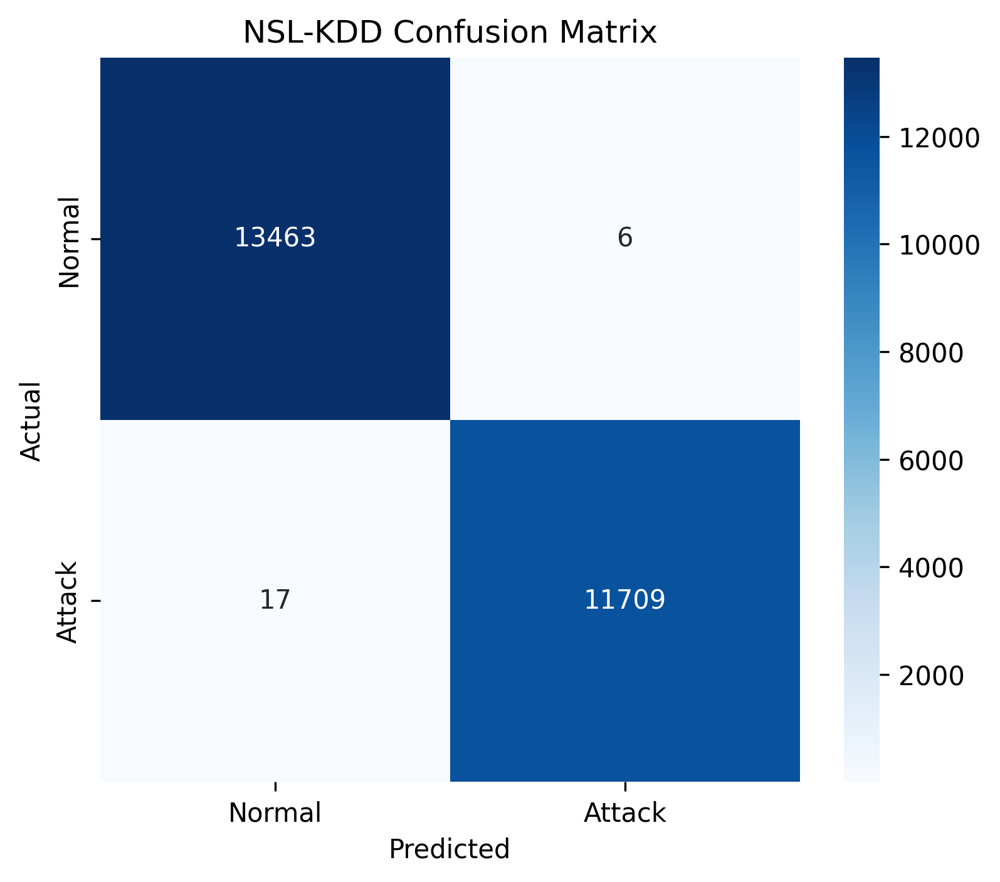 | 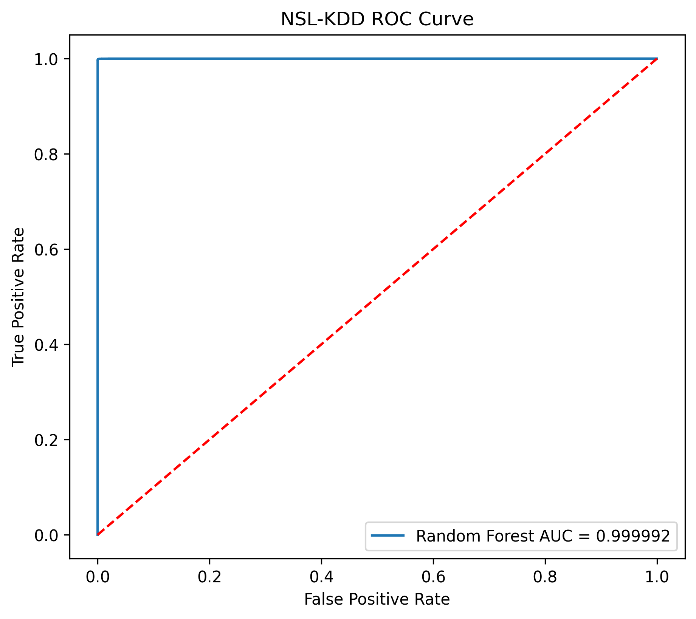 | 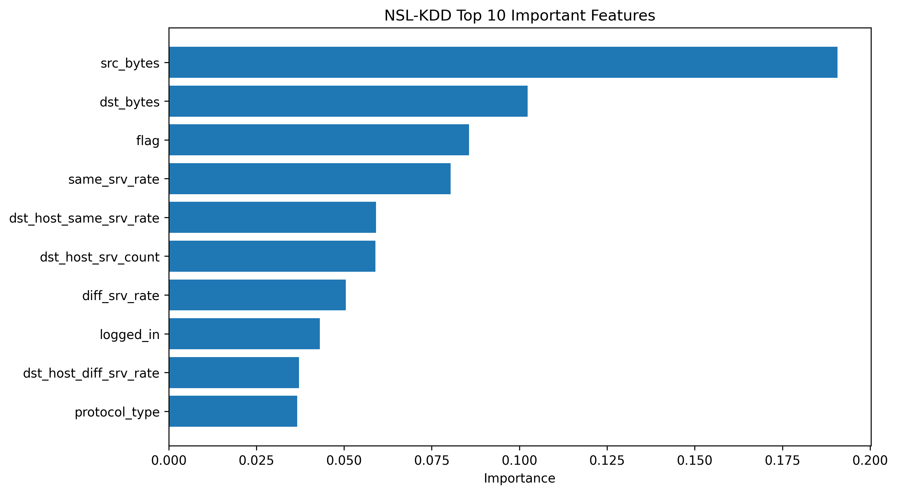 |
| **CICIDS-2017** | 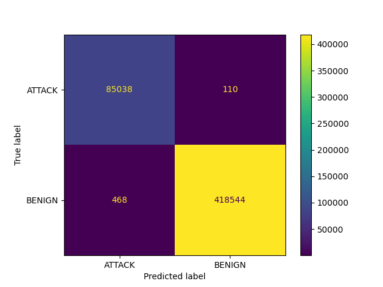 | 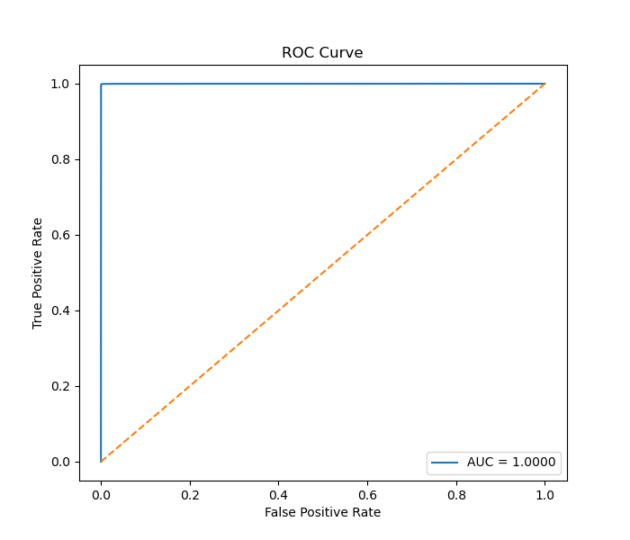 | 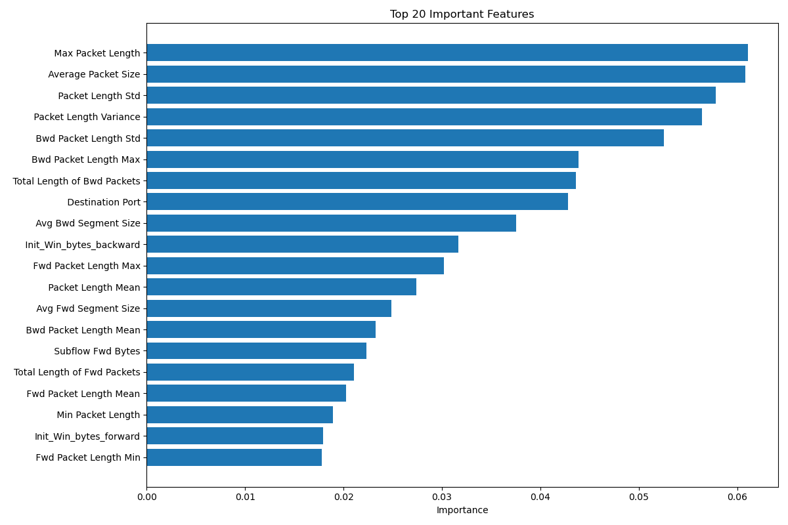 |

---

## 🖼️ Web Application Screenshots

| Page | View | Description |
| :---: | :---: | :--- |
| **1** | 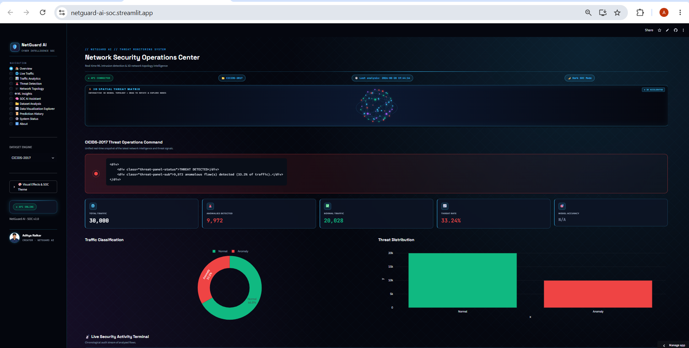 | **Executive Dashboard & Hero View**: KPI metrics, live threat radar, 3D topology matrix. |
| **2** | 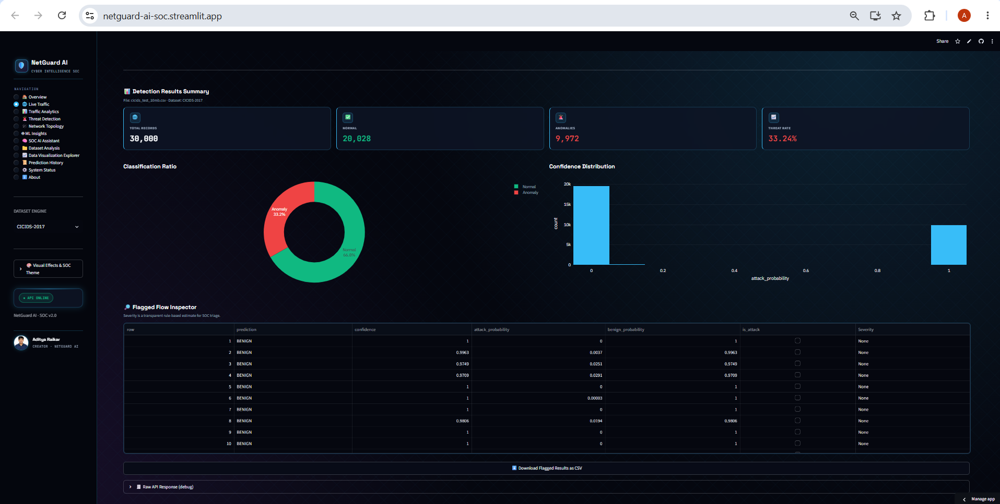 | **Live Traffic Monitor**: Real-time packet interception, flow assembly, and anomaly scoring. |
| **3** | 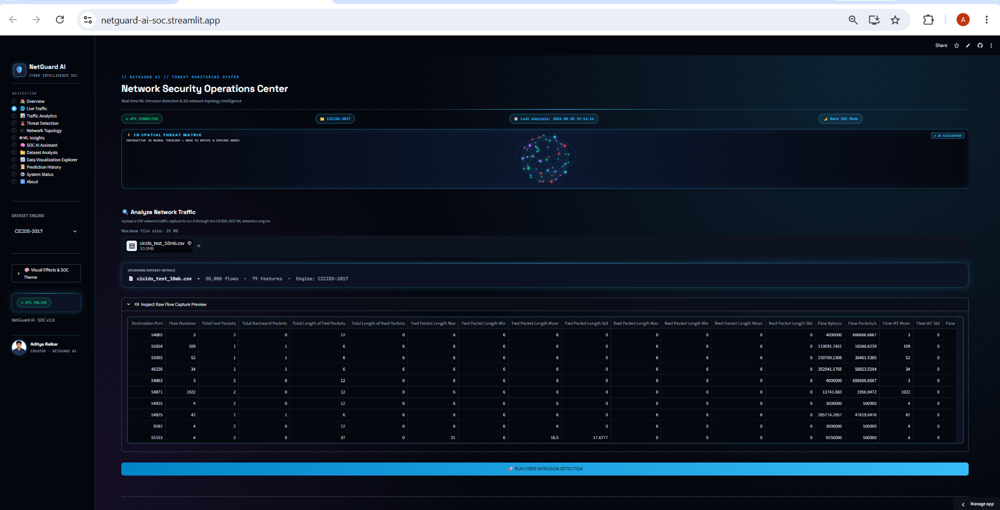 | **Traffic Analytics**: Interactive time-series trends and protocol distributions. |
| **4** | 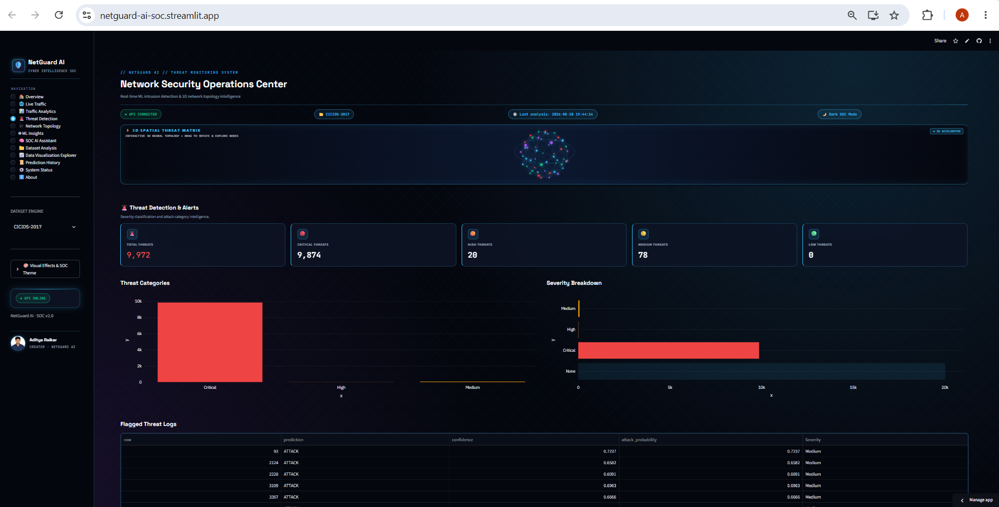 | **Threat Detection Console**: Risk scores, severity indicators, and XAI feature attribution. |
| **5** | 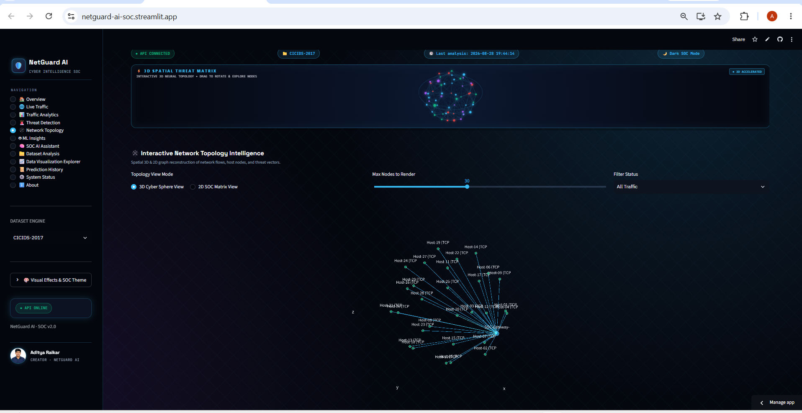 | **3D Neural Topology Visualizer**: WebGL interactive node communication graph. |
| **6** | 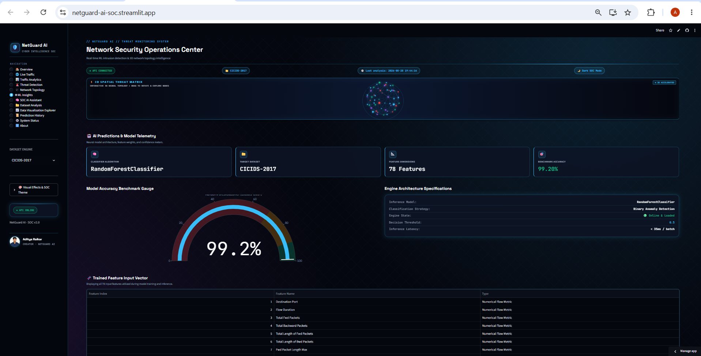 | **ML Telemetry & Insights**: Feature importance curves and model inference metrics. |
| **7** | 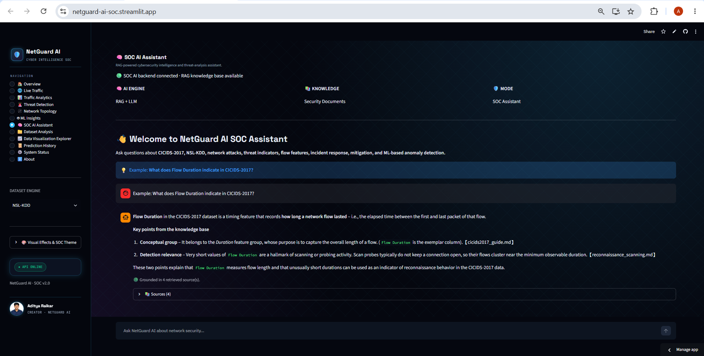 | **RAG SOC AI Assistant**: Contextually grounded cybersecurity incident response chat. |
| **8** | 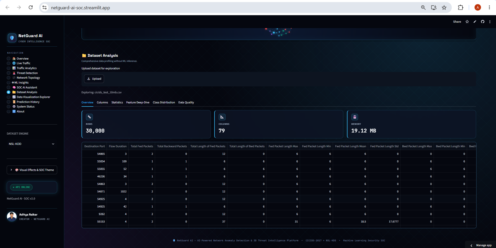 | **Dataset Analysis**: Batch CSV/PCAP inspection with anomaly rate breakdown. |
| **9** | 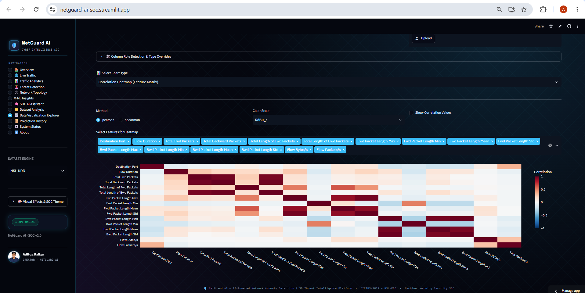 | **Data Explorer**: Distribution histograms and cross-feature correlations. |
| **10** | 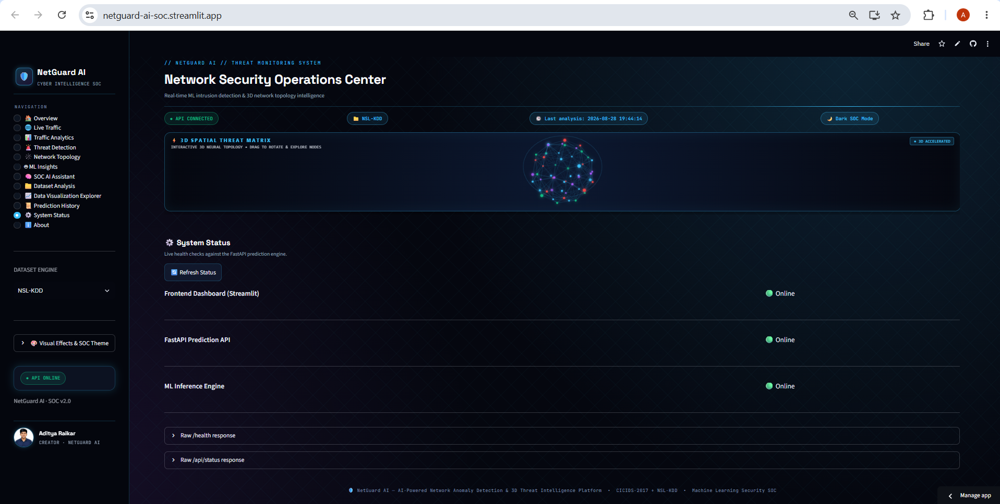 | **System Status**: Engine health, RAG vector index size, and endpoint latency telemetry. |

---

## 🔒 Security, Privacy & Deployment Safety

- **No Secrets Committed**: `.env`, session credentials, and API keys are strictly excluded via `.gitignore`.
- **Database Safety**: Local SQLite database files (`*.db`) containing user hashes and tokens are strictly excluded from version control.
- **Dataset Guardrails**: Massive multi-gigabyte raw dataset CSVs are excluded from git to keep repository cloning fast and lightweight.
- **Digital Chain-of-Custody**: Incident dossiers generated by the cryptographic packager include SHA-256 and SHA-512 hashes adhering to ISO/IEC 27037 standards.

---

## 🛠️ Technologies Used

- **Languages & Frameworks**: Python 3.11 / 3.13, FastAPI, Uvicorn, Streamlit.
- **Machine Learning & Data Science**: Scikit-Learn (Random Forest), NumPy, Pandas, Joblib.
- **Networking & DPI**: Scapy, pure-Python binary PCAP/PCAPNG parser.
- **Agentic AI & LLMs**: Groq (`llama-3.3-70b-versatile`), Google Gemini 1.5, OpenAI GPT-4o, Ollama.
- **Cryptography & Security**: Bcrypt, PyJWT, Python `hashlib` (SHA-256, SHA-512).
- **Visualization & UI**: Plotly, Streamlit, HTML5/CSS3 glassmorphism, Three.js WebGL canvas.
- **Testing & Quality Assurance**: Pytest (61 passed tests), ReportLab (PDF documentation).

---

## 👨‍💻 Author & Acknowledgments

**Aditya Raikar**  
- **Degree**: Bachelor of Engineering — Computer Science & Engineering  
- **Project**: Major Project — *NetGuard AI: Network Anomaly Detection & SOC Platform*  
- **Repository**: [https://github.com/adityaraikar5555-collab/NetGuard-AI](https://github.com/adityaraikar5555-collab/NetGuard-AI)

> **Disclaimer**: *NetGuard AI is developed for academic research, cybersecurity education, and enterprise SOC prototyping. Always ensure proper legal authorization before running network packet capture or active evasion testing on production networks.*
